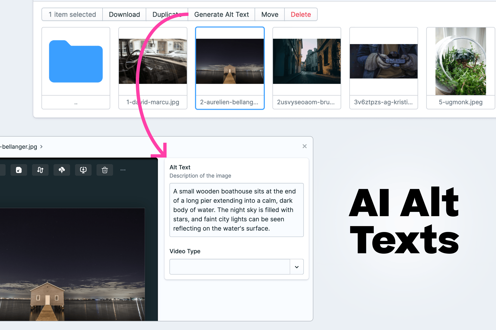

# Statamic AI Alt Generator

AI-powered alt text generation for Statamic assets using OpenAI, Claude or Gemini through the [Laravel AI SDK](https://laravel.com/docs/ai-sdk).



## Features

- Automatically generates alt text for images with OpenAI, Anthropic (Claude) or Gemini
- Works with JPG, PNG, Webp and GIF files (SVG is not supported)
- Available in both list and detail views
- Queued job processing to handle large batches

## Requirements

- Statamic 6.0+
- PHP 8.3+
- An API key for OpenAI, Anthropic or Gemini
- Laravel Queue worker (for background processing)

## Installation

1. Install the package:
```bash
composer require croox/statamic-ai-alt
php artisan vendor:publish --tag=statamic-ai-alt --force
```

1. Add the API key of your provider and the target language to your `.env` file:

```env
# One of: openai, anthropic, gemini (empty: the default of config/ai.php)
AI_ALT_PROVIDER=anthropic
ANTHROPIC_API_KEY=<your-api-key-here>
# OPENAI_API_KEY=<your-api-key-here>
# GEMINI_API_KEY=<your-api-key-here>

# Optional: a specific model (empty: the provider's cheapest model)
# AI_ALT_MODEL=

# Language of the alt text
AI_ALT_LANGUAGE="English"
```

### Upgrading from 2.x

`OPENAI_ALT_LANGUAGE` and `OPENAI_MODEL` are now `AI_ALT_LANGUAGE` and `AI_ALT_MODEL`. `OPENAI_API_KEY` stays as it is; set `AI_ALT_PROVIDER=openai` if `config/ai.php` defaults to another provider.

## Usage
1. In the Assets section of the Control Panel, select one or more images
2. Click the "Generate Alt Text" action
3. The alt text will be generated in the background and saved to your assets

In the asset editor, the wand on a textarea field with the handle `alt` fills the field right away. Nothing is saved until you save the asset.


## Future ideas / missing features
- Support SVG
- Check for existing alt text before overriding with API results

## License
[LICENSE](./LICENSE.txt)  
[](https://opensource.org/licenses/MIT)
